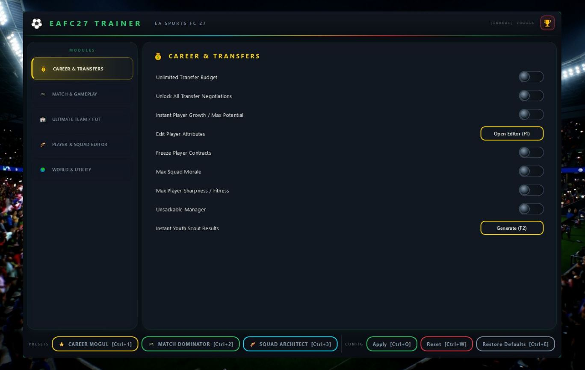
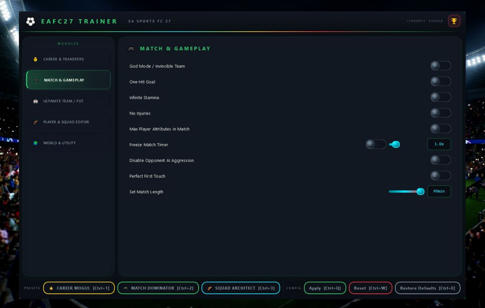
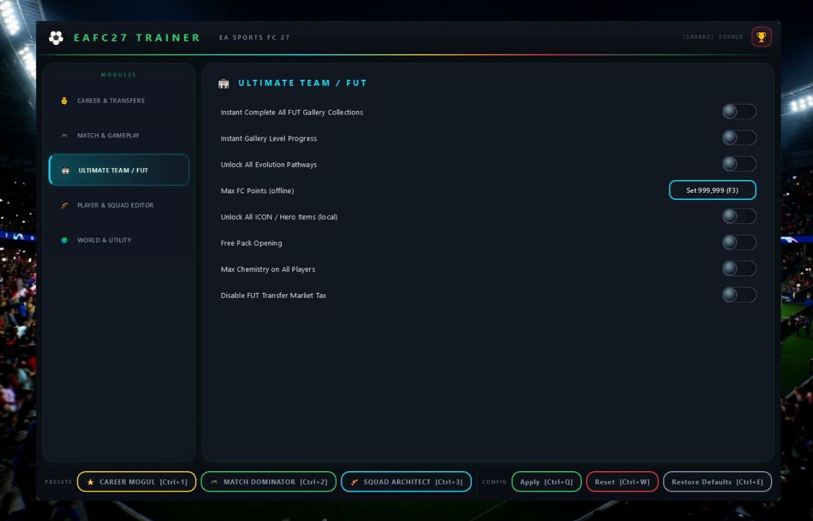
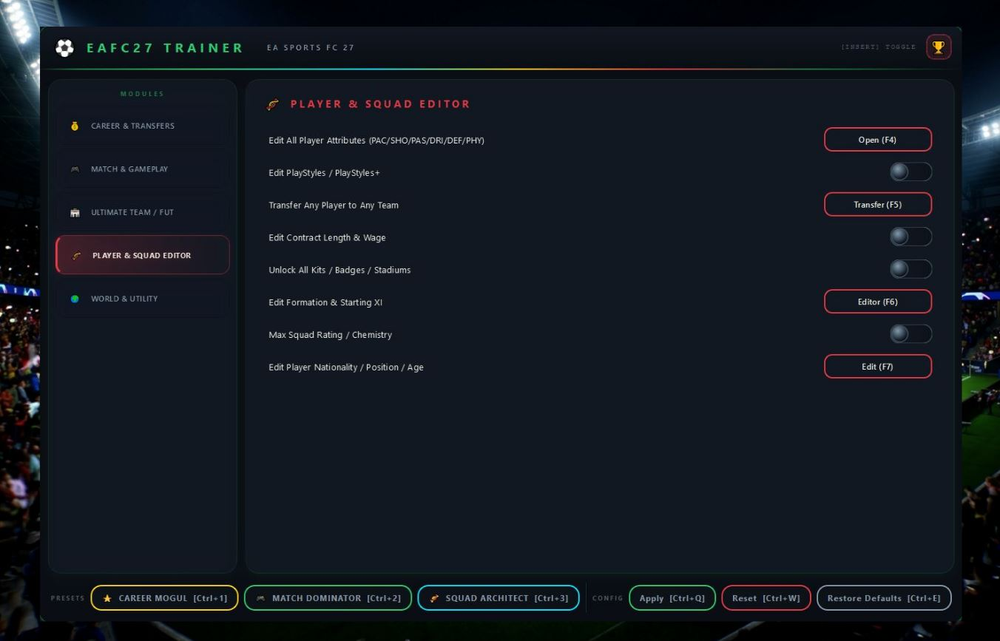
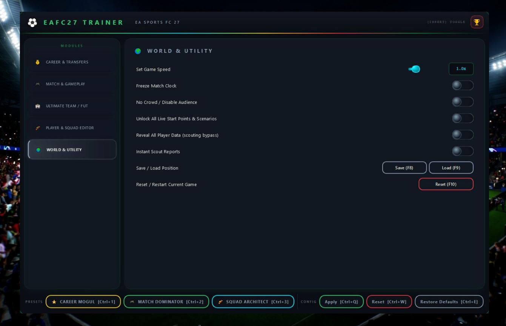

# 🎮 EA FC 27 Panel — 42-Module Game Enhancer for Windows

   

---

eafc27-panel is a 42-module trainer built for EA SPORTS FC 27, covering career mode, Ultimate Team, live match control, player editing, and world utilities in a single tool. Every module is purpose-built for its game system: nine career and transfer features, nine match and gameplay tools, eight FUT modules, eight player and squad editors, and eight world and utility options. Presets like Career Mogul, Match Dominator, and Squad Architect bundle the most-used combinations so you can get in and out fast. Settings save automatically on exit, and everything stays organized in clean profile and log folders.

## Features

**eafc27-panel packs 42 modules into one panel — built for players who want full control over EA SPORTS FC 27, not a stripped-down cheat with three toggles.**

The toolkit is organized into five module groups. Every feature listed below ships in the panel — no locked tiers, no upsells.

### Career & Transfers — 9 modules
Take over the transfer window and the boardroom. Unlimited transfer budget that never drains. Every negotiation unlocked from day one. Players hit max potential instantly, contracts never expire, and squad morale stays pinned at the ceiling. Edit any player's attributes freely, keep everyone at peak sharpness and fitness, and make the manager seat untouchable — no sacking, no matter the results. Youth scouting returns reports immediately instead of making you wait out the calendar.

### Match & Gameplay — 9 modules
Full command over the pitch. Invincible team mode, one-hit goals on every shot on target, infinite stamina, and zero injuries. Lock every rating at 99 for the duration of a match, freeze the clock whenever you want, and dial opponent AI aggression down to minimum. Perfect first touch on every ball, plus configurable match length from 1 to 90 minutes.

### Ultimate Team / FUT — 8 modules
Built for grinding without the grind. Complete all FUT gallery collections instantly and push gallery levels forward on demand. Unlock every evolution pathway and skip the requirements. Max offline FC Points, all ICON and Hero items available in local mode, and free pack openings. Every player runs 3-star chemistry, and the transfer market tax gets switched off entirely.

### Player & Squad Editor — 8 modules
The deep editor. Modify PAC, SHO, PAS, DRI, DEF, and PHY on any player. Assign any PlayStyle or PlayStyle+ freely. Move any player to any club, set contract length and wages to whatever you want, and unlock all kits, badges, and stadiums immediately. Edit formations and starting XIs, lock squad rating and chemistry at max, and change nationality, position, or age on any player.

### World & Utility — 8 modules
The controls around the game. Game speed from ×0.5 to ×5.0, match clock freeze, crowd and crowd audio removal, and all Live Start Points and scenarios unlocked from the start. Reveal all player data instantly, get scout reports back immediately, save and load any position, and restart the current match at any time.

**Presets** bundle the modules for common playstyles: Career Mogul for budget and squad management, Match Dominator for gameplay control, and Squad Architect for full player editing.

**Hotkeys:** `INSERT` opens and closes the panel. `F12` disables everything instantly.

All settings auto-save on exit, with configs in the `profiles/` folder and logs in `logs/`. Press `INSERT` at any time to bring the panel back up.

## How It Works

The panel runs as a standalone process alongside EA SPORTS FC 27 and hooks into the game's live memory while a session is active. Launch order matters: get the panel up first, then start the game through Steam or EA App, and press `INSERT` once you're in a menu or a match to pull up the overlay. No injection at startup, no file swaps — every toggle is applied on the fly.

Under the hood, the 42 modules are grouped into five functional layers that share a single read/write pipeline. Career and transfer modules write directly to save-state values for budget, contracts, morale and scouting timers. Match modules latch onto the live gameplay loop, which is why toggles like God Mode, Infinite Stamina or the match-clock freeze take effect instantly mid-game and reset cleanly on restart. FUT modules operate on local session data — gallery progress, evolution gates, chemistry and pack logic — and are scoped to offline and local modes only. The player editor and world tools read the loaded database and commit any edits to the active profile, so attribute changes, transfers, formation tweaks and cosmetic unlocks persist the next time you load that save.

Each feature is an isolated module, meaning you can flip one on without dragging the rest along. Presets are just saved bundles of module states — Career Mogul, Match Dominator and Squad Architect each restore a known-good configuration in one click. Settings auto-save on exit and live in the `profiles/` folder, so your loadout survives between sessions. Logs go to the `logs/` folder if you ever need to trace what a toggle touched.

`INSERT` opens and closes the overlay at any time. `F12` is the panic switch — it disables every active module in one hit, no menu diving. Windowed or borderless mode is required for the overlay to render over the game; run the panel as administrator if the menu doesn't appear on first launch.

## Supported Games

Built for **EA SPORTS FC 27** on PC — that's it, that's the target. Every one of the 42 modules is tuned to the current Steam / EA App build, so what you see in the feature list is what actually works in your game.

**Fully covered:**
- **Career Mode** — transfers, budgets, contracts, scouting, youth academy, manager status
- **Ultimate Team** — gallery, evolutions, chemistry, packs, ICONs and Heroes
- **Match Day** — gameplay modifiers, stamina, injuries, AI behavior, match clock
- **Player & Squad Editing** — attributes, PlayStyles, formations, contracts, identity data
- **World Tools** — game speed, live scenarios, scouting data, snapshots, restarts

**Version note:** the panel tracks the live game build. If EA pushes a patch that shifts memory offsets, the affected modules get flagged rather than silently failing — check the release notes before a session if you're on a fresh update.

**Not supported:** console versions, mobile, or any pre-FC 27 title. This is a PC-only toolkit for the current game, no legacy compatibility layer, no half-measures.

## 📸 Screenshot

## Configuration

Everything in eafc27-panel is built to be configured live, in-game, without alt-tabbing to a text editor. Open the overlay, tune your modules, close it — settings stick.

### Config Profiles

Create, name, and switch between unlimited profiles. Each profile stores the full state of all 42 modules: which are active, every slider value, and every hotkey binding. Load a profile before a career session, swap to a different one for FUT, swap back — no re-toggling a single checkbox.

- Profiles save to the local `profiles/` directory next to the panel executable
- Auto-save fires on overlay close and on clean game exit
- Export and import profiles as single files to move a setup between machines or back it up before a patch

### Module Toggles

Every module has its own master switch. Flip individual features on and off from the overlay without touching the rest of your loadout — God Mode off, Infinite Stamina on, everything else untouched. Toggles apply instantly; no match restart required.

### Hotkey Bindings

Every module toggle and every preset can be bound to a key. Defaults ship with the panel, but nothing is locked:

- Rebind any action to any key
- Modifier combos supported (Ctrl, Alt, Shift)
- Conflict detection flags duplicate bindings before they cause a double-fire
- Bindings are stored per profile, so your career layout and your match layout can share the same physical keys for different actions

### Numeric Tuning

Sliders and value fields are live-editable and take effect on the next tick — no confirmation dialog, no reload.

- Game Speed: ×0.5 to ×5.0 in 0.1 steps
- Match Length: 1 to 90 minutes
- Contract length, wage, and attribute values: typed directly into the field
- All numeric inputs accept keyboard entry for precise values the sliders can't hit

### Presets

Three one-click loadouts ship pre-tuned: Career Mogul, Match Dominator, and Squad Architect. Applying a preset writes its module states into the active profile — it does not lock anything. Tweak from there; the preset is a starting point, not a cage.

### Reset and Restore

A single action reverts every module to its default state without wiping your profile. Use it when a session goes sideways, then reload your saved profile and you're back where you were. Position snapshot and match reset live in the World & Utility modules and pair with configuration — snapshot state, reconfigure, restore if needed.

### Where Things Live

- `profiles/` — saved configurations and profile exports
- `logs/` — session and debug output for troubleshooting a config that won't apply

If a setting refuses to stick, check the log first — it records rejected values and binding conflicts by name.

## FAQ

**Does this work with the latest EA SPORTS FC 27 patch?**
Yes. eafc27-panel is built for the current Steam / EA App build. When EA ships a title update, the panel gets re-synced. If a module ever goes dark after a patch, check the release notes before assuming it's broken — running an outdated build against a fresh game version is the #1 cause of "nothing happens."

**Do I need to be in a specific game mode for modules to apply?**
Most do, some don't. Career and transfer tools need an active career save loaded. Match features only bite once you're in a match. FUT modules are scoped to local/offline contexts — the panel doesn't touch server-side values, so online modes behave differently by design. Player editor works anywhere a squad is loaded.

**The menu won't open. What gives?**
Three usual suspects: the game isn't in windowed or borderless mode, the panel isn't running as administrator, or you launched the game after the panel instead of the other way around. Fix the order, elevate the process, and hit `INSERT`. If it's still dead, `F12` kills all active modules — press it once and retry.

**Are my settings saved between sessions?**
Automatically. Everything writes to the `profiles/` folder on exit. Load a new career and your toggles carry over — no re-clicking 42 modules every time you boot the game. Logs land in `logs/` if you ever need to trace what fired.

**Is this safe to use?**
It's an offline-focused trainer. FUT and world modules that touch live-service values are deliberately constrained to local scopes — don't expect server-side FC Points or market changes to stick, because they won't. Treat it as a single-player power tool, not a competitive-edge cheat. The Disclaimer section spells out the risk surface; read it.

**Can I run presets instead of toggling modules one by one?**
That's what they're for. **CAREER MOGUL** flips budget, transfer and squad-management modules in one shot. **MATCH DOMINATOR** handles gameplay and stamina. **SQUAD ARCHITECT** arms the full editor suite. Load a preset, then trim individual toggles as needed.

**Will a single module break the whole panel?**
No. Modules are independent. If one feature misbehaves, `F12` disables everything instantly and you can re-enable selectively to isolate the culprit. Isolating beats guessing — flip one at a time.

**Does the panel conflict with other overlays or trainers?**
Overlay tools and other memory-editing software can fight over the same hooks. Run eafc27-panel clean — no competing trainers, minimal overlays. Conflicts look like flickering menus or modules that toggle themselves back; that's your signal to close the other tool.

## Disclaimer

This trainer is provided strictly as-is, for offline and single-player use. It's built for EA SPORTS FC 27 on Windows 10/11, and that's the only environment it's tested against — run it on anything else and you're on your own.

**Use it at your own risk.** Modifying game memory and save data can corrupt your profiles, break career files, or brick a FUT session beyond repair. Back up your saves before you touch anything. If something goes sideways, that's on you, not on the project.

**Online is off the table.** This tool is not designed, tested, or intended for online play. Using it in any online mode — FUT Rivals, Champions, co-op, anything with another human on the other end — risks a ban from EA and ruins the game for everyone else. Keep it offline. No exceptions, no workarounds, no "just this once."

**No guarantees.** The 42 modules work as described, but patches happen. Game updates can break features overnight, and functionality isn't promised to survive the next title update. What works today may not work tomorrow — that's the nature of game enhancement tools, and you should know that going in.

**Not affiliated.** This project has no connection to EA, EA SPORTS, or any of their subsidiaries. All trademarks and game assets belong to their respective owners. This is an independent community tool.

**You are responsible for how you use it.** The developers and contributors of this panel accept no liability for account bans, data loss, hardware issues, or any other consequence of running modified software. If you're not comfortable with those terms, don't run it.

